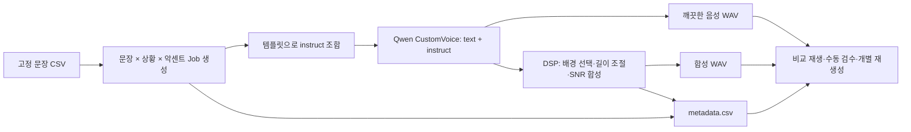

# Scenario TTS

**정해진 영어 문장을 여러 상황에 맞춰 연출하는 배치 TTS 생성기**입니다. 같은 문장을 다큐 내레이션, 카페 대화, 역 안내 방송 등으로 읽게 하고, 상황에 맞는 배경음을 합성해 비교할 수 있습니다.

기본 실험 규모는 **문장 5개 × 상황 6개 × 요청 악센트 2개 = 60개**입니다. Qwen3-TTS 1.7B CustomVoice와 사람이 작성한 프롬프트 템플릿을 사용합니다. 모델 학습·미세조정, 음성 복제, LLM을 이용한 프롬프트 작성은 포함하지 않습니다.

## 처리 구조와 구현 기능



| 기능 | 구현 방법 | 주요 코드 |
| --- | --- | --- |
| CSV 입력과 조합 생성 | 문장 ID·원문 검증, 문장 × 상황 × 악센트의 모든 조합을 `Job`으로 구성 | [`read_sentences`, `create_jobs`](scenario_tts/batch.py) |
| 상황별 발화 지시 | 악센트 지시 + 상황 템플릿 + 원문 유지 지시를 조합 | [`PRESETS`, `build_instruction`](scenario_tts/presets.py) |
| 실제 음성 생성 | 모델을 필요할 때 한 번 로드하고 `generate_custom_voice` 호출 | [`QwenBackend`](scenario_tts/backends.py) |
| 배경음 합성 | 모노 변환·리샘플링·구간 선택·반복·페이드·RMS SNR 조절 | [`mix_audio`](scenario_tts/audio.py) |
| 배치 저장과 재실행 | 조건별 ID, 파일 유효성 확인, 실패 기록, WAV·CSV의 임시 파일 교체 저장 | [`generate_batch`](scenario_tts/batch.py) |
| 비교와 검수 | Gradio에서 원음/합성음 재생, 개별 재생성, 네 항목을 `reviews.csv`에 저장 | [`create_app`](scenario_tts/ui.py), [`app.py`](app.py) |
| 명령행 실행 | 모델 없이 계획만 내보내기, Demo 또는 Qwen 배치 생성 | [`cli.py`](scenario_tts/cli.py) |
| 독립 자동 음성 검수 | Whisper 전사와 원문 비교, 저장된 WAV에서 SNR·클리핑·길이·pitch 재계산 | [`audit_audio.py`](scripts/audit_audio.py) |

## 설치와 실행

Python **3.10 이상, 3.14 미만**을 사용합니다. 새 환경은 Python 3.12를 권장합니다. 저장소 루트에서 [uv](https://docs.astral.sh/uv/)로 설치할 수 있습니다.

```powershell
uv venv --python 3.12
uv pip install -e ".[dev]"

# 실제 Qwen 음성 생성에 필요한 추가 의존성
uv pip install -e ".[tts]"
```

저장소의 `uv.lock`에 기록된 버전으로 설치하려면 아래 명령을 사용하세요. 모델 없이 Demo·자동 테스트만 실행할 때는 `--extra tts`를 빼면 됩니다.

```powershell
uv sync --frozen --extra dev --extra tts
uv run --no-sync python app.py
```

일반 `python -m venv`와 `pip install -e ".[dev,tts]"`도 사용할 수 있습니다. Windows PowerShell에서는 `.\.venv\Scripts\Activate.ps1`, macOS/Linux에서는 `source .venv/bin/activate`로 가상환경을 활성화합니다. 아래 명령은 활성화한 환경 기준이며, 활성화하지 않으면 앞에 `uv run --no-sync`를 붙이세요.

CUDA GPU를 사용하려면 시스템에 맞는 PyTorch가 필요합니다. [PyTorch 설치 안내](https://pytorch.org/get-started/locally/)를 확인하세요. 현재 장치 선택은 CPU와 NVIDIA CUDA를 지원하며 Intel GPU·Apple MPS를 자동으로 사용하지 않습니다. CPU에서도 동작하지만 1.7B 모델 생성은 느릴 수 있습니다. 처음에는 모델·토크나이저 다운로드에 네트워크, 저장 공간과 충분한 메모리가 필요합니다. FlashAttention 설치는 필수가 아닙니다.

### 화면 사용

```powershell
python app.py
```

브라우저에서 `http://127.0.0.1:7860`을 엽니다. 로컬 주소로 실행하며 공개 공유 링크를 만들지 않습니다.

1. 예제 문장 또는 `sentence_id,text` CSV를 불러오고 생성할 문장을 선택합니다.
2. 상황과 요청 악센트를 선택하고 **조합과 프롬프트 미리보기**로 작업 수·원문·지시를 확인합니다.
3. 세부 설정에서 톤, 화자, 배경음, SNR, seed와 실행 장치를 조절합니다.
4. **선택한 조합 생성** 후 원음과 합성음을 비교합니다.
5. 특정 샘플만 새 seed로 재생성하거나 네 가지 검수 항목을 저장합니다.

`Demo · 비음성 테스트 신호`는 모델 없이 합성·저장·화면 흐름을 확인하는 용도입니다. **문장을 읽지 않으며 톤·악센트 품질을 평가할 수 없습니다.** 음성 품질 검수는 Qwen 결과에서 진행합니다.

### CLI 사용

```powershell
# 기본 60개 조합과 지시만 계획합니다. 모델은 로드하지 않습니다.
scenario-tts plan data/sentences.csv --output outputs/plan.csv

# 모델 없이 전체 파이프라인 확인: 비음성 테스트 신호 60개
scenario-tts generate data/sentences.csv --backend demo --output outputs/demo

# 실제 TTS: 예제 5문장 × 한 상황 × 한 악센트
scenario-tts generate data/sentences.csv --backend qwen --presets documentary --accents american --output outputs/qwen-smoke

# 실제 TTS: 기본 60개 전체 조합
scenario-tts generate data/sentences.csv --backend qwen --output outputs/qwen-full

# 직접 준비한 배경 WAV로 합성
scenario-tts generate data/sentences.csv --backend qwen --presets cafe station --accents american british --background-dir assets/backgrounds --snr-db 10 --output outputs/custom-backgrounds
```

주요 옵션은 `--device cpu` / `--device cuda:0`, `--speaker Ryan` / `Aiden`, `--seed 123`, `--tone "Speak warmly and slowly."`, `--background room`, `--snr-db 20`입니다. CLI의 `--attention`은 `auto`, `eager`, `sdpa`, `flash_attention_2`를 지원합니다. `--max-new-tokens`의 기본값은 `2048`이며 너무 작게 설정하면 발화가 잘릴 수 있습니다. 전체 옵션은 `scenario-tts generate --help`에서 확인하세요.

## 발화 연출 방법

### 상황 preset

각 preset은 **누구에게, 어떤 의도로, 어떻게 말할지**와 어울리는 배경을 함께 정합니다. 톤·악센트·배경을 무작위로 섞는 방식이 아닙니다.

| preset 키 | 상황 / 발화 방식 | 기본 배경 | 기본 SNR |
| --- | --- | --- | --- |
| `documentary` | 청중에게 차분하게 설명하는 다큐 내레이터; 일정한 속도, 절제된 감정 | `none` | 적용 안 함 |
| `cafe` | 맞은편 친구에게 편하게 대화; 자연스러운 억양과 속도 | `cafe` | 20 dB |
| `station` | 승객에게 안내 방송; 또렷한 발음, 시간·장소·지시 강조 | `station` | 10 dB |
| `urgent` | 친구에게 서두르라고 전달; 빠르되 명료하고 소리 지르지 않음 | `street` | 10 dB |
| `reassuring` | 불안한 상대를 안심시킴; 부드럽고 안정적인 속도 | `room` | 20 dB |
| `excited` | 친구에게 좋은 소식을 전달; 밝고 들뜬 억양 | `none` | 적용 안 함 |

배경이 없는 두 preset에도 배경을 직접 지정할 경우 사용할 기본 SNR 20 dB가 저장되어 있습니다. 세부 설정의 톤 지시는 상황의 발화 지시를 **대체**하고, 악센트와 원문 유지 지시는 그대로 붙습니다. 배경과 SNR은 별도로 변경할 수 있습니다. `crowd` 배경도 직접 선택할 수 있습니다.

### `text`와 `instruct`의 분리

원문은 CSV에서 읽은 `text`로 전달합니다. 모델에 원문을 고치도록 요청하지 않습니다. 예를 들어 `urgent + american`은 실제 `build_instruction`에서 다음과 같이 구성됩니다.

```python
text = "The next train will arrive in five minutes."

instruct = (
    "Use a General American accent.\n"
    "You are telling a friend that they need to hurry. "
    "Sound urgent but controlled. Use brisk pacing and clear articulation. "
    "Emphasize time information when present. Convey urgency without screaming.\n"
    "Speak exactly the supplied text. Do not add, omit, or paraphrase words."
)
```

British를 선택하면 첫 줄이 `Use a contemporary Southern British English accent.`로 바뀝니다. 이 지시는 발음과 원문 유지를 **요청**하는 것이며, 모델 출력의 정확성을 보장하지 않습니다.

### Qwen 추론과 seed

모델은 `Qwen/Qwen3-TTS-12Hz-1.7B-CustomVoice`이며 언어는 `English`, 기본 화자는 `Ryan`입니다. `Aiden`도 지원합니다. [공식 Qwen3-TTS 인터페이스](https://github.com/QwenLM/Qwen3-TTS)에 맞춰 `generate_custom_voice(text=..., language="English", speaker=..., instruct=...)`를 호출합니다.

| 자동 설정 | CPU | CUDA GPU |
| --- | --- | --- |
| 장치 | CUDA를 사용할 수 없으면 `cpu` | 사용할 수 있으면 `cuda:0` |
| dtype | `float32` | BF16 지원 시 `bfloat16`, 아니면 `float16` |
| attention | `eager` | `sdpa` |

모델은 실제 생성이 필요할 때 로드하고 재사용합니다. 한 번에 여러 문장을 모델에 넣는 병렬 추론 대신, **Job을 하나씩 순차 처리**합니다. 프로세스 내 모델 추론에는 잠금을 사용해 동시에 실행된 작업의 난수 상태가 서로 섞이지 않게 합니다. 각 생성에서 Python·NumPy·PyTorch의 seed를 설정하고, 종료 후 기존 난수 상태를 복원합니다.

실제 Job의 seed는 기준 seed와 문장 ID·원문·상황·악센트·화자에서 해시로 계산합니다. 따라서 선택 순서를 바꾸거나 일부 조합만 생성해도 같은 조건의 seed는 유지됩니다. 기준 seed와 각 샘플 seed는 같은 값일 필요가 없습니다. UI의 개별 재생성은 아직 사용하지 않은 새 seed의 Job을 추가하고 원본을 보존합니다.

## 배경음 합성과 SNR

배경은 TTS 생성 후 별도의 DSP 단계에서 더합니다. 기본 배경은 필터링한 잡음과 변조 등으로 만든 **절차적 근사음**이며, 실제 카페·역·거리 녹음이 아닙니다. 직접 준비한 `cafe.wav`, `station.wav`, `street.wav`, `room.wav`, `crowd.wav`로 교체할 수 있습니다. 파일 준비와 출처 기록은 [배경음 안내](assets/backgrounds/README.md)를 참고하세요.

배경이 있을 때의 처리 순서는 다음과 같습니다.

1. WAV의 채널을 평균해 모노로 만들고, 필요하면 `scipy.signal.resample_poly`로 음성의 샘플레이트에 맞춥니다.
2. seed에 따라 배경 시작 위치를 선택합니다. 긴 파일은 자르고, 짧은 파일은 연결부에 최대 **50 ms 교차 페이드**를 적용해 반복합니다. 매우 짧은 파일에서는 교차 페이드 길이가 제한되므로 긴 배경 파일을 권장합니다.
3. 음성 앞뒤에 기본 **0.5초**씩 배경만 나오는 구간을 추가하고, 배경 시작과 끝을 **0.2초** 선형 페이드합니다.
4. 아래 식으로 배경 크기를 조절한 뒤 음성과 더합니다.
5. 합성 신호의 peak가 **0.98**을 넘으면 음성과 배경에 같은 gain을 적용해 SNR을 유지하며 감쇠합니다.

음성을 $s$, 페이드와 길이 조절을 마친 배경을 $n$, 목표 SNR을 $R$ dB라고 하면:

$$
\mathrm{RMS}(x)=\sqrt{\frac{1}{N}\sum_{i=1}^{N}x_i^2},\qquad
\alpha=\frac{\mathrm{RMS}(s)}{10^{R/20}\,\mathrm{RMS}(n_W)}
$$

$$
y=s_{\mathrm{padded}}+\alpha n,\qquad
g=\min\left(1,\frac{0.98}{\max |y|}\right),\qquad
y_{\mathrm{saved}}=g y
$$

여기서 $W$는 앞뒤 배경 전용 구간을 제외한 **원래 음성 파형 전체 길이**입니다. 음성 내부의 쉬는 구간도 RMS에 포함하며, 음성 활동 검출(VAD)을 적용한 지표는 아닙니다. `achieved_snr_db`는 $20\log_{10}(\mathrm{RMS}(s)/\mathrm{RMS}(\alpha n_W))$로 기록합니다. 음성과 배경에 같은 $g$가 적용되므로 이 비율은 유지됩니다.

원음 WAV에도 저장 전 별도의 peak 0.98 감쇠가 적용될 수 있으므로, 여기서 $s$는 그 처리를 마친 원음입니다. `mix_gain`은 그 이후 합성 단계의 gain입니다. 배경이 `none`이면 **여백과 페이드를 추가하지 않으며 SNR은 적용하지 않습니다.**

UI의 약함 / 보통 / 강함은 **20 / 10 / 5 dB**의 초기 설정입니다. 이 값은 음성과 배경의 상대 RMS 크기이며, 실제 장소의 음압 수준이나 사람에게 들리는 시끄러움을 재현했다는 뜻이 아닙니다.

## 입력·출력과 재실행

입력 CSV는 UTF-8이며 `sentence_id,text` 열이 필요합니다. ID는 문자열로 유지하므로 `001`이 `1`로 바뀌지 않습니다. ID 중복, 빈 문장, 잘못된 행은 오류로 처리합니다. 쉼표가 있는 문장은 CSV 규칙에 따라 따옴표로 감싸세요.

```csv
sentence_id,text
001,The next train will arrive in five minutes.
002,Please leave your bag beside the door.
```

UI는 실행별로 `outputs/날짜_고유값/` 폴더를 만듭니다. CLI는 `--output`으로 폴더를 지정합니다.

```text
outputs/<run>/
  clean/          # 배경이 없는 원음 WAV
  mixed/          # 배경을 합성한 WAV
  metadata.csv    # 생성 조건, 환경, 파일 경로, 음향 설정, 성공/오류
  reviews.csv     # UI에서 저장한 수동 검수 (선택)
```

WAV는 모노 float 형식이며 모델이 반환한 샘플레이트를 유지합니다. `metadata.csv`에는 원문, 상황, 요청 악센트, 화자, `instruct`, seed, backend·모델·패키지 버전, 실제 장치·dtype·attention, 요청/측정 SNR, 배경 출처·시작 위치, gain과 파일 경로가 기록됩니다.

`sample_id`는 Job의 조건을 반영하며 `artifact_id`에는 backend·모델 ID·실행 설정과 배경 파일의 내용 해시도 반영됩니다. **같은 출력 폴더**에서 같은 조건을 다시 실행하면 성공 기록과 WAV의 채널·샘플레이트·길이를 확인해 기존 파일을 재사용합니다. 조건이 달라지면 별도 결과로 저장하고, 실패했거나 유효하지 않은 파일은 다시 생성합니다. 모든 결과가 이미 유효하면 모델을 로드하지 않습니다.

각 샘플이 끝날 때 생성 정보를 저장하며, 일부 샘플이 실패해도 나머지는 계속 처리합니다. CLI는 실패가 하나라도 있으면 0이 아닌 종료 코드를 반환합니다. 같은 출력 폴더를 두 프로세스가 동시에 쓰는 것은 잠금 파일로 막습니다. UI의 새 배치 생성은 새 폴더를 사용하므로 이전 실행을 자동으로 재개하지는 않습니다.

## 품질 검수와 범위의 한계

| 검수 항목 | 확인할 내용 |
| --- | --- |
| 문장 정확성 | 원문과 비교해 누락·반복·추가 단어 확인 |
| 톤 구분 | 같은 문장의 여러 상황을 비교해 전달 의도와 속도·억양 확인 |
| 악센트 | American/British 요청이 실제 발음에 반영됐는지 확인 |
| 소음 크기 | 배경 때문에 단어가 가려지거나 듣기 불편하지 않은지 확인 |

검수값은 미검수 / 예 / 아니오와 메모로 저장합니다. 이전 샘플을 다시 선택하면 저장한 값을 불러옵니다. 음성 품질을 자동 합격 처리하지 않으며 Demo 신호에는 음성 검수 결과를 저장할 수 없습니다.

- 고정 화자에게 악센트를 요청하지만 **동일 화자의 악센트 변환이나 American/British 구분 성능을 보장하지 않습니다.** 차이가 부족하면 향후 reference voice 기반의 ‘악센트별 화자 preset’이 별도 구현으로 필요합니다.
- 프롬프트의 원문 유지 지시만으로 누락·반복을 막을 수 없습니다. 파일 생성 성공, 자동 테스트 통과, 수치상 SNR 일치는 발음·감정 표현의 품질 판정과 다릅니다.
- seed와 실행 정보를 기록하지만 모델 revision·하드웨어까지 고정한 환경은 아닙니다. 모델·패키지·장치가 바뀌면 같은 seed라도 WAV가 달라질 수 있습니다.
- 기본 배경은 파이프라인을 확인하기 위한 근사음입니다. 실제 장소의 자연스러움이나 현실적인 방송 장비 음색·잔향을 재현하는 모델은 포함하지 않습니다.

## 실제 음성 검수 결과 — 2026-11-24

**이번 소규모 표본에서는 문장 전달과 음향 합성이 정상 동작했습니다. 상황별 속도·톤·악센트의 정확한 제어까지 검증된 것은 아닙니다.** 실제 Qwen 1.7B / Ryan / CPU 결과를 [Whisper의 별도 구현인 faster-whisper](https://github.com/SYSTRAN/faster-whisper)로 검사하고 저장된 WAV를 수치 분석했습니다. 직접 청취나 사람이 매긴 자연스러움 점수는 아닙니다.

- 문장 `001`의 **6개 상황 × 2개 요청 악센트 = 12개**, 문장 `002`~`005`의 Documentary / American **4개**, 총 **16개**를 평가했습니다. 기존 4개 파일을 재사용하고 12개를 추가 생성했습니다. 전체 60개의 실제 음성을 검수한 결과는 아닙니다.
- Whisper `small.en`, CPU INT8, beam size 5로 원음과 최종 합성본을 각각 전사했습니다. **정답 문장·상황·악센트·프롬프트를 인식기에 제공하지 않았습니다.**
- 대소문자·구두점·숫자 `0`~`20`의 표기 차이를 정규화한 뒤 `WER = (대체 + 삭제 + 삽입 단어 수) / 원문 단어 수`로 비교했습니다. ASR은 오류를 놓치거나 문맥으로 보정할 수 있으므로 WER 0이 완벽한 발음을 보증하지는 않습니다.

| 항목 | 관측 결과 | 해석 범위 |
| --- | --- | --- |
| 실제 생성 | 16/16 성공 | WAV 생성과 저장 성공 |
| 원음 전사 | 16/16 정규화 원문 일치, WER 0% | 이번 5종 문장의 표본에서 인식 가능한 내용 유지 |
| 최종 합성본 전사 | 16/16 일치, WER 0% | 기본 10/20 dB 근사 배경 추가 후에도 전사 일치 |
| WAV / 클리핑 | 32개 모두 mono 24 kHz·유한 값, `abs(sample) >= 1`인 값 0개 | 디지털 파형 유효성; 주관적 소음 평가는 아님 |
| 배경 포함 8개 SNR | 목표와의 최대 오차 약 `2.4 × 10⁻⁸ dB` | 파일에서 배경 성분을 복원해 독립 재계산 |
| 요청 악센트·자연스러움 | 미검증 | 전사와 pitch만으로 American/British 정확도를 판정하지 않음 |

배경이 없는 8개 조건은 원음과 최종본이 같습니다. 같은 문장 `001`을 반복한 표본이 대부분이며, 5 dB 설정의 실제 음성 인식·실제 장소 녹음·Aiden·다른 긴 문장은 이번 평가에 포함하지 않았습니다.

### 확인된 차이와 부족한 점

같은 문장 `001`의 전체 발화 길이는 다음과 같습니다. 단어 사이의 쉼도 포함합니다.

| 상황 | American 요청 | British 요청 |
| --- | ---: | ---: |
| Documentary | 2.40초 | 2.32초 |
| Café | 2.48초 | 2.16초 |
| Station | 2.16초 | 2.88초 |
| Urgent | 2.40초 | 2.72초 |
| Reassuring | 3.20초 | 3.12초 |
| Excited | 2.08초 | 2.64초 |

Reassuring은 두 요청 악센트에서 Documentary보다 길었지만, **Urgent는 American에서 길이가 같고 British에서는 더 길었습니다.** 따라서 `brisk pacing` 지시가 항상 더 빠른 발화를 만든다고 설명하면 안 됩니다. 길이와 pitch가 달라졌다는 사실도 원하는 감정이 잘 전달됐다는 증거는 아닙니다. 각 조건의 seed가 달라 프롬프트 효과와 무작위 생성 차이가 섞여 있습니다. 제어 성능을 평가하려면 같은 seed의 조건 비교, 여러 seed 반복, 독립 청취 평가가 추가로 필요합니다.

[16개 비교 샘플](examples/quality-audit/README.md), [상세 검수 방법·결과](reports/quality-audit-2026-11-24/README.md), [전체 전사 CSV](reports/quality-audit-2026-11-24/samples.csv), [설정·수치 JSON](reports/quality-audit-2026-11-24/audit.json)을 함께 제공합니다. 자동 검수 결과는 사람의 검수 파일인 `reviews.csv`에 합격으로 기록하지 않습니다.

### 자동 검수 재실행

생성기와 별도의 선택 의존성을 사용합니다. 아래는 Windows PowerShell 기준이며 macOS/Linux에서는 마지막 실행 파일을 `.cache/qa-venv/bin/python`으로 바꾸면 됩니다.

```powershell
uv venv .cache/qa-venv --python 3.12
uv pip install --python .cache/qa-venv/Scripts/python.exe -r requirements-audit.txt
.cache/qa-venv/Scripts/python.exe scripts/audit_audio.py examples/quality-audit --output outputs/re-audit --model small.en --pitch
```

Whisper 모델은 최초 실행 시 다운로드합니다. `--pitch`는 [librosa의 pYIN](https://librosa.org/doc/main/generated/librosa.pyin.html)으로 음높이 통계를 추가하며 악센트·감정을 분류하지 않습니다. 검수 도구의 종료 코드 0은 **측정 완료**를 뜻하고 품질 자동 합격을 뜻하지 않습니다. WAV 해시와 인식 설정이 같은 전사는 재사용합니다.

## 코드·동작 검증

2026-11-24 로컬 테스트는 **88개 통과, 1개 skip**입니다. Skip은 Windows의 symlink 생성 권한 제한 때문입니다. WER 계산, 파일에서의 독립 SNR 복원, 잘못된 파형과 경로 검사도 포함합니다.

초기 구현은 Windows/Linux × Python 3.10/3.12의 [CI](https://github.com/myjju08/AI618_TTS/actions/runs/45190359126), Demo 60개 생성·재실행, Gradio HTTP API의 생성·다운로드·재생성을 통과했습니다. 최신 CI 상태는 [Actions](https://github.com/myjju08/AI618_TTS/actions)에서 확인할 수 있습니다. 브라우저 클릭 자동화는 도구의 URL 검증 차단으로 완료하지 못했습니다.

```powershell
pytest -q
```

단위 테스트는 모델 다운로드 없이 CSV 검증, 조합 생성, TTS 호출 인자, 실패 처리, SNR과 파일 저장 등을 확인합니다. 자동화 테스트 통과는 청취 품질 평가와 구분합니다.

모델 다운로드가 Xet 전송에서 멈추는 환경에서는 실행 전에 PowerShell의 `$env:HF_HUB_DISABLE_XET="1"` 또는 macOS/Linux의 `export HF_HUB_DISABLE_XET=1`을 설정해 일반 HTTP 다운로드로 재시도할 수 있습니다. 위 Windows 검증에서는 이 설정으로 다운로드를 완료했습니다.
